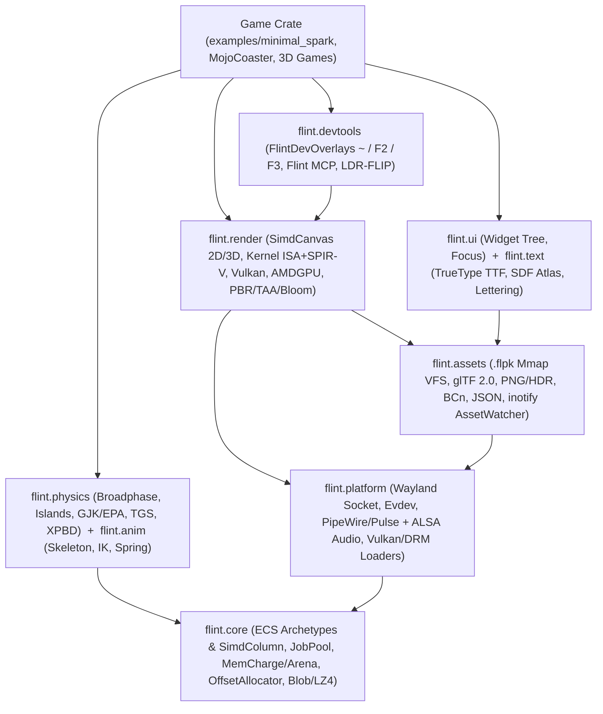

# Flint Engine Architecture

## 1. Design Philosophy

Flint is built around four engineering invariants:

1. **100% Pure Mojo 1.2 (Zero C/C++ Engine Dependencies)**: Every protocol, file format, allocator, physics solver, and GPU instruction stream is authored directly in Mojo. On Linux, Flint talks straight to kernel syscalls (`socket`, `memfd_create`, `futex`, `inotify`, `ioctl`) and standard driver Loader ABIs (`libvulkan.so.1` or `/dev/dri/renderD*`).
2. **Strict Engine / Game Separation**: Zero game-specific rules, entity kinds, or voxel terrain assumptions exist inside `src/flint/`. `tools/sync_from_deepsong.sh` enforces an automated **Zero-Game-Leak Gate** across all modules on every sync.
3. **Deterministic Simulation Across Thread Counts**: Authoritative state lives in 8-lane-padded `SimdColumn[dtype]` Structure-of-Arrays tables (`flint.core.ecs`), serialized bit-exactly via `BlobWriter` + `LZ4`, and stepped in parallel through `JobPool` + `run_parallel_ctx` with `--fp-mode contract=off`.
4. **Scale Down to Laptop iGPUs, Scale Up to Discrete RDNA4 / Vulkan GPUs**:
   - **`SimdCanvas`** renders mixed 3D lit meshes, 3D beams, and 8-wide SIMD depth-tested 2D sprites in `< 4 MiB` of RAM — ideal for laptops, isometric/2.5D games, UI tools, and headless CI.
   - **`Kernel` (`flint.render.kernel`)** compiles a single Mojo compute kernel definition into **both** AMD RDNA (`ISA_GFX11`/`ISA_GFX12`) machine words and **Vulkan 1.2 SPIR-V 1.3** words (`SPIRV_MAGIC = 0x07230203`), paired with `OffsetAllocator` for O(1) VRAM sub-allocation.

---

## 2. Layered Package Architecture



---

## 3. Mojo 1.2 Parallel Lifetime Safety (`run_parallel_ctx`)

Mojo 1.2 uses eager "As-Soon-As-Possible" (ASAP) destruction for local values after their last syntactic read. Passing a stack-allocated job context address (`Int(Pointer(to=ctx))`) to worker threads without anchoring `ctx` after the barrier risks premature stack reclamation.

`flint.core.ecs.run_parallel_ctx` encapsulates this pattern safely:

```mojo
def run_parallel_ctx[CtxType: Movable](
    mut pool: JobPool,
    job_count: Int,
    mut ctx: CtxType,
    worker_fn: JobBody,
):
    var ctx_addr = Int(Pointer(to=ctx))
    run_jobs(Int(Pointer(to=pool)), worker_fn, ctx_addr, job_count)
    var keep_alive_anchor = Int(Pointer(to=ctx))
    _ = keep_alive_anchor
```

---

## 4. Upstream Sync & Decoupling Shims

When new pure-Mojo rendering, audio, or math capabilities land in `Deepsong`, pull them into Flint with a single command:

```bash
bash tools/flint.sh sync /path/to/Deepsong
```

Three lightweight decoupling shims in `src/flint/` replace game-specific imports automatically during sync:
- `flint/physics/defaults.mojo`: Supplies ` SolverDefaults` constants (`GRAVITY_Y`, Baumgarte `CONTACT_BETA`, sleep thresholds) without `gameplay.tunables`.
- `flint/physics/filter.mojo`: Supplies generic 32-bit `CollisionFilter` layer/mask bitmasks.
- `flint/render/occupancy_layout.mojo`: Supplies generic 3D spatial occupancy constants (`OCCUPANCY_CELL`, `OCCUPANCY_SIDE`) for GPU ambient shadow/GI passes without voxel terrain coupling.
