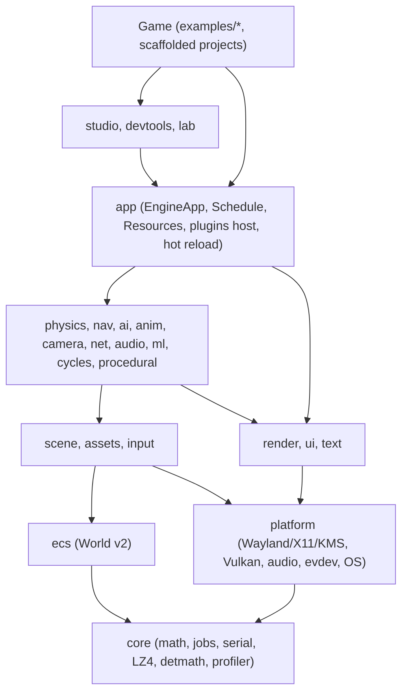

# Flint Engine Architecture

A map of `src/flint/` (~240k lines of Mojo 1.2 in 23 packages): what each package does, its key
types, and how a frame flows through `EngineApp`. Written from the code; where a module docstring
claims more than the code does, this document follows the code.

Legend: **[Linux]** works only on Linux (raw syscalls, `/dev` nodes, Linux sockets).
**[Exp]** experimental: unused by the shipping path, test-only, or with known gaps.

## 1. Design invariants

1. **Pure Mojo, no C/C++ wrapper libraries.** Windowing, audio, input, file watching and networking
   talk to the kernel (`socket`, `ioctl`, `futex`, `inotify`, `memfd_create`) and to system
   protocols (Wayland wire format, X11/XCB, DRM/KMS, PulseAudio native protocol, D-Bus for logind)
   directly. GPU work goes through the system Vulkan loader (`libvulkan.so.1`, opened with `dlopen`).
   The one non-system dependency is Modular's `max-core` package, used by `flint.ml.gpu` for GPU
   matrix products.
2. **Engine/game separation.** `src/flint/` never imports `gameplay.*` or `world.*` and contains no
   game names. `tools/sync_from_deepsong.sh --verify` checks this and runs at the start of the gate
   and of `tools/ci.sh`.
3. **Deterministic simulation.** ECS state, the parallel schedule and command playback are
   designed so 1 and N worker threads give the same `World.state_checksum()`; the ECS suites check
   this. Everything is compiled with `--fp-mode contract=off`, and `flint.core.detmath` gives
   deterministic transcendental functions.
4. **Scale down, then up.** Every render path has a CPU fallback (`SimdCanvas`, render tier 0), so
   games, Studio and tests run headless with no GPU; the Vulkan renderer is used when a device is
   available.

## 2. Package layers



The layering is a convention, not enforced: for example `flint.assets.server` imports the `Resource`
trait from `flint.app`, and many packages import `flint.platform.os` for file I/O.

## 3. Packages

### Foundation

| Package | Lines | What it does | Key types / functions |
| :--- | ---: | :--- | :--- |
| `core` | 9.9k | Math (`Vec3`, `Quat`, `Mat4`), deterministic trig (`detmath`), stable sort and heaps (`detsort`), the `JobPool` work-stealing job graph, `BlobWriter`/`BlobReader` binary serialization, LZ4, memory accounting (`MemCharge`, `Arena`, `OffsetAllocator`), logging, crash handler, console variables, frame profiler, replays, build stamp. Also the legacy `SimdColumn` ECS tables and `run_parallel_ctx`. | `JobPool`, `run_parallel_ctx`, `BlobWriter`, `lz4_pack`, `ProfileTimeline`, `DevConsole`, `check_flint_version_pin` |
| `ecs` | 3.8k | ECS v2: hybrid archetype tables (64-row, 64-byte aligned chunks) plus paged sparse sets, per-8-row change ticks, deferred per-worker command buffers with deterministic playback, double-buffered events, binary snapshot/restore and checksums. See [ECS_GUIDE.md](ECS_GUIDE.md). | `World`, `Entity`, `Component`, `ComponentBitSet`, `ParallelCommands`, `Events[T]` |
| `platform` | 23k | OS layer. Wayland client (xdg-shell, zero-copy fullscreen), X11/XCB, DRM/KMS bare-display output with logind input fallback, Vulkan loader and device setup, PulseAudio client and ALSA, evdev, xkb keymaps, `dlopen` wrapper, file/time/env helpers. **[Linux]** except the pure helper code. | `WaylandWindow` (owns X11/KMS fallbacks), `X11Window`, `KmsWindow`, `VulkanGpu`, `NativeAudio`, `dl_open` |

Platform notes:

- `macos_window.mojo`, `macos_audio.mojo`, `win32_window.mojo`, `win32_audio.mojo` contain Cocoa
  and Win32 backends, but nothing outside those files constructs them and the toolchain is only
  installed for Linux. **[Exp]** Windows players run the Linux build under WSL2 (`package --profile` with `platform = "windows-wsl2"`).
- `amdgpu.mojo` / `amd_isa.mojo` (direct RDNA command submission and an ISA assembler) and
  `render/kernel.mojo` (one compute kernel encoded as RDNA ISA and SPIR-V) are exercised only by
  tests; the renderer reuses just the `GpuBuffer` struct. **[Exp]**

### Runtime

| Package | Lines | What it does | Key types |
| :--- | ---: | :--- | :--- |
| `app` | 2.3k | `EngineApp`: owns `World`, `Resources`, the 8-stage `Schedule` and the `JobPool`; `AppConfig`; `EnginePlugin`; `WindowPlugin`; fixed-timestep `FixedTime`; game flow helpers (`GameFlow`, `Tween`, `SaveSlotStore`); `HotReloadHost` and the `FlintPluginApiV2` C ABI for gameplay `.so` plugins (uses `dlopen`, **[Linux]**). | `EngineApp`, `Schedule`, `Resources`, `HotReloadHost` |
| `scene` | 3.3k | Transform hierarchy (`LocalTransform`, `GlobalTransform`, `Parent`/`Children`, dirty-chunk cached parallel propagation), `TransformPlugin`, the `SerializableComponent` trait and `ComponentRegistry` codecs, `.flscn` JSON / `.flscnb` LZ4 scenes with migrations, nested prefabs (`.flprefab`), Play-In-Editor snapshots. | `Scene`, `Prefab`, `ComponentRegistry`, `TransformPlugin` |
| `assets` | 21k | `AssetServer` (mounted `.flpk` v3 packs with mmap, loose directories, generational handles, refcounts, LRU, budgeted mip streaming, async loads, inotify hot reload **[Linux]**), codecs (PNG, JPEG, HDR, KTX2, BC1-7 encoder, GLB 2.0 reader/writer, JSON), asset cooker, meshlet builder, `MeshBuilder`, `.flmat` materials, checkpoints and replay streams. | `AssetServer`, `Handle[T]`, `AssetPlugin`, `write_flpk_v3`, `parse_native_glb` |
| `input` | 2.1k | `InputMap` actions and contexts (keys, mouse, pads, deadzone curves, buffering, coyote time, JSON rebinding, deterministic tick packing), evdev gamepads with rumble **[Linux]**, `InputPlugin`. | `InputMap`, `InputContext`, `InputPlugin` |

### Simulation

| Package | Lines | What it does | Key types |
| :--- | ---: | :--- | :--- |
| `physics` | 25k | Rigid bodies (hash-grid and BVH broadphase, GJK/EPA narrowphase, TGS contact solver, XPBD constraints, islands and sleeping, CCD), shapes (sphere, capsule, box, Quickhull convex hull, BVH8 triangle mesh, heightfield, compound with a "V-HACD-lite" decomposition), joints, `CharacterController`, `VehicleChassis` with tires, 6-DoF aero, water buoyancy and wind, `PhysicsPlugin`. | `PhysicsWorld`, `PhysicsPlugin`, `RigidBodyComponent`, `ColliderComponent` |
| `nav` | 4.5k | Tiled voxel navmesh built from physics geometry (Recast-style voxelization, but polygons come from greedy rectangle decomposition, not Recast's region/contour pipeline), dynamic obstacle carving, off-mesh links, A* with funnel smoothing, ORCA crowd avoidance, `NavPlugin`. | `NavMesh`, `NavPlugin`, `NavAgentComponent` |
| `ai` | 1.6k | Flattened behavior trees with blackboards and abort modes, utility scoring, `AiPlugin`. | `BehaviorTree`, `UtilityAiScorer`, `AiPlugin` |
| `anim` | 12.6k | Skinning, poses, `.flanim` state-machine graphs and `.flrig` rigs, motion matching, two-bone and mecha IK, foot planting, spring bones, correctives, ragdoll state machine, bone sockets, combat timing presets, SOMA retargeting, `AnimPlugin`. | `AnimPlugin`, `SkeletonInstance`, `RagdollStateMachine` |
| `camera` | 0.4k | `CameraRig`: first-person, orbit-follow (spring arm), rail-dolly and free-fly modes. | `CameraRig` |
| `net` | 11.3k | Non-blocking dual-stack UDP (`recvmmsg`/`sendmmsg` **[Linux]**), bit packing with smallest-three quaternions, reliable/unordered channels with 1180-byte fragmentation, ChaCha20-Poly1305 sessions with cookie handshake, `NetHub`, 4-peer GGPO-style `RollbackSession`, AOI `SnapshotReplicator`, lag compensation, a deterministic `VirtualNetSim` for tests, `NetPlugin`. The crypto is hand-written and has not been externally audited. **[Exp]** for security-sensitive use. | `UdpSocket`, `NetChannel`, `RollbackSession`, `SnapshotReplicator` |
| `audio` | 5.3k | `AudioServer`: lock-free command ring to a real-time mixing thread, buses, spatial voices with Woodworth ITD HRTF, BS.1770 loudness limiter, QOA codec, BVH8 raycast acoustics with Sabine RT60 estimates, `AudioPlugin`. Output via `flint.platform` PulseAudio/ALSA **[Linux]**; null output when headless. | `AudioServer`, `AudioPlugin`, `AudioEmitterComponent` |
| `procedural` | 6.2k | Catmull-Clark subdivision, loft/bevel, ArchKit building kit, foliage, fern baking, rigged crowd generation (VAT data for the renderer). | `subd`, `arch_kit`, `crowd_rig` |
| `cycles` | 4.5k | TidalCycles-style live-coding pattern language and synth (`flint.sh cycles`, see [CYCLES.md](CYCLES.md)). | `CyclesEngine` |
| `ml` | 4.9k | ONNX protobuf loader and CPU interpreter (mmapped weights, SIMD + `JobPool` kernels), MAX GPU matrix products, the MotionBricks SOMA motion-inbetweening runtime and Kimodo text-to-motion helpers. Models are not in the repository (see `licenses/`); the tests skip those parts when the models or a MAX GPU are missing. **[Exp]** | `OnnxModel`, `flint.ml.motionbricks` |

### Presentation

| Package | Lines | What it does | Key types |
| :--- | ---: | :--- | :--- |
| `render` | 45k | `ScalableRenderer` with three tiers (below), `RenderWorld` double-buffered extraction from ECS, `RenderPlugin`. CPU path: `SimdCanvas` 8-wide SIMD rasterizer with depth. GPU path: `FlintAaaVulkanRenderer` (Vulkan 1.3, dynamic rendering): meshlet visibility buffer, bindless BC textures, clustered lights, virtual shadow maps, ray-query shadows/reflections/GI with SVGF and ReBLUR-style denoising, TSR, sky/atmosphere, froxel fog, water, glass, GPU particles, NPR cel/outline, render graph barriers. Shaders are emitted as SPIR-V from Mojo (`spirv.mojo`, `shader_dsl.mojo`, `material_graph.mojo` with `OpSpecConstant` specialization). Also FLIP image comparison, debug draw, the GPU SDF UI overlay pass. | `ScalableRenderer`, `RenderPlugin`, `SimdCanvas`, `FlintAaaVulkanRenderer` |
| `ui` | 9k | Immediate-mode `UiContext` with cached Flexbox layout, `UiDrawList` of GPU SDF primitives (CPU raster fallback), Flexbox layout and `DockSpace`, themes, vector icons, spring-damper animation, HUD helpers. | `UiContext`, `UiDrawList`, `DockSpace` |
| `text` | 7.4k | TrueType parser, SDF atlas baking, OpenType shaping (GSUB/GPOS subset), UAX #9 bidi, line breaking, rich text, UTF-8. The runtime font atlas type, `SdfFont`, lives in `render/font.mojo`. | `ttf`, `sdf_bake`, `shaper` |

Render tiers (`flint.render.render_world`):

| Tier | Constant | Meaning |
| :--- | :--- | :--- |
| 0 | `RENDER_TIER_0_HEADLESS_SIMD` | CPU only (`SimdCanvas`). Used automatically when Vulkan cannot start. |
| 1 | `RENDER_TIER_1_FORWARD_CLUSTERED` | The same Vulkan renderer with ray tracing, SVGF, ReBLUR, fog, DoF and motion blur switched off. It is not a separate forward renderer. |
| 2 | `RENDER_TIER_2_AAA_VISBUFFER_RT` | Everything on; ray-traced features only when the device supports `VK_KHR_ray_query`. |

### Tools

| Package | Lines | What it does |
| :--- | ---: | :--- |
| `studio` | 28k | Flint Studio editor (`examples/studio/main.mojo` is the entry): viewport picking and gizmos, undo/redo, inspector and outliner, Play-In-Editor, command palette, motion/combat/traversal-room editors, profile comparison, embedded TurboMojo IDE (PTY), AI agent panels and "Agent Theatre" visualizations. The agent and IDE features are **[Exp]**. |
| `devtools` | 8.9k | MCP v2 server (JSON-RPC over stdio and a Unix socket **[Linux]**) used by `flint.sh mcp` and Studio, in-game overlays (`~` console, profiler, memory), ACP client, diff view, compiler diagnostics parser, syntax highlighter, background job runner. |
| `lab` | 0.5k | `EngineBenchSuite`: p50/p99 timing, dual-run determinism hashing, golden-frame FLIP checks for `labs/lab_*.mojo` (`flint.sh lab`). |

## 4. A frame through `EngineApp`

`EngineApp.step_one_frame(dt)` (`src/flint/app/engine_app.mojo`):

```text
clamp dt to [0, max_frame_dt]; update FrameTime
STAGE_FIRST          window_poll -> input.update; net.poll                         -> flush commands
STAGE_PRE_UPDATE     physics.pre_sync, asset tick, ragdoll cleanup                  -> flush
FixedTime.advance_frame(dt) = N steps (0..max_fixed_steps_per_frame, spiral-of-death clamp)
  repeat N times:
    world.advance_tick()
    STAGE_FIXED_UPDATE physics.fixed_step, nav.crowd_step, net.fixed_step,
                       prev-transform snapshot                                      -> flush
STAGE_UPDATE         game logic, ai.behavior_tree_tick, anim.update -> foot_plant
                     -> ragdoll -> bone_sockets                                     -> flush
STAGE_POST_UPDATE    scene.propagate_transforms -> net.replicate, nav debug         -> flush
STAGE_LAST           render.extract_and_draw, audio.sync, game present             -> flush
event-swap hooks (physics, anim, headless input Events[T] buffers)
world.advance_tick()
```

`startup()` compiles the schedule, starts the worker threads and runs `STAGE_STARTUP`;
`shutdown()` runs `STAGE_SHUTDOWN` and stops the pool. Within a stage, systems are nodes in a
job graph: edges come from explicit `after_system_id` dependencies and from read/write conflicts on
`ComponentBitSet`s (and `exclusive=True`), in registration order. A stage with no edges is
dispatched in one `run_parallel_ctx` call. Resource access is not tracked by the scheduler.

## 5. Parallel lifetime safety (`run_parallel_ctx`)

Mojo 1.2 destroys a local after its last use. A job context passed to workers as a raw address
can therefore be destroyed while workers still read it. `flint.core.ecs.run_parallel_ctx` takes the
context by `mut` reference and touches it again after the barrier:

```mojo
def run_parallel_ctx[CtxType: Movable](
    mut pool: JobPool,
    job_count: Int,
    mut ctx: CtxType,
    worker_fn: JobBody,
):
    var ctx_addr = Int(Pointer(to=ctx))
    run_jobs(Int(Pointer(to=pool)), worker_fn, ctx_addr, job_count)
    var keep_alive_anchor = Int(Pointer(to=ctx))
    _ = keep_alive_anchor
```

Data reached through the context (columns, lists) must also outlive the call: `SimdColumn` and
`World` expose `keep_alive()` for this. See AGENTS.md section 2.

## 6. Platform support

| Area | Linux | Other |
| :--- | :--- | :--- |
| Toolchain (`pixi.toml`) | x86_64, aarch64 | none |
| Window | Wayland, X11, DRM/KMS (+ Vulkan `VK_KHR_display`) | macOS/Win32 code present, not wired up **[Exp]**; Windows via WSL2 bundle |
| GPU | Vulkan 1.3 via `libvulkan.so.1`; CPU fallback | - |
| Audio | PulseAudio/PipeWire native protocol, ALSA fallback; null when headless | macOS/Win32 audio code present, unused **[Exp]** |
| Input | Wayland/X11 seat, evdev, logind on KMS | - |
| Asset hot reload | inotify | - |
| Networking | `recvmmsg`/`sendmmsg` UDP | - |
| Gameplay hot reload | `dlopen` of `.so` | - |

## 7. Upstream sync and decoupling shims

`bash tools/flint.sh sync /path/to/Deepsong` harvests game-agnostic modules from the Deepsong
game, rewrites imports to `flint.*`, skips files Flint has extended (`FLINT_ENHANCED` in
`tools/sync_from_deepsong.sh`) and runs the leak gate. Three shims stand in for game modules:

- `flint/physics/defaults.mojo`: solver constants (gravity, contact Baumgarte factor, sleep thresholds).
- `flint/physics/filter.mojo`: 32-bit `CollisionFilter` layer/mask bits.
- `flint/render/occupancy_layout.mojo`: occupancy-grid constants for the GPU ambient/GI passes.

## 8. Known documentation drift

The README's feature list still names modules that are no longer in the tree
(`render/gpu_raster.mojo`, `scene_renderer`, `vulkan_backend`, `GpuSceneRenderer`,
`FlintMcpLiveEndpoint`), and `core/build_info.mojo` refers to `tools/build.sh`, which is now
`tools/flint.sh` (`write_build_stamp`). Prefer this document and the code.
