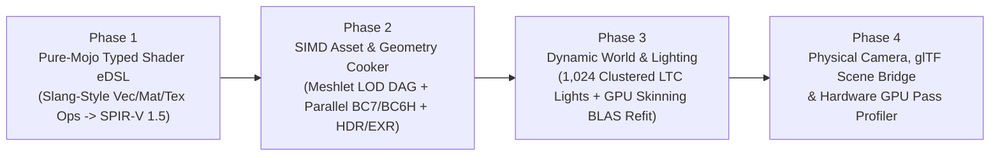

# Pure-Mojo AAA Rendering Pipeline Roadmap (`Flint Engine` `V16 -> V19`)

> [!IMPORTANT]
> **Scope:** Strictly **AAA Rendering Pipeline** inside `/home/user/flint/src/flint/` — replacing every layer that a traditional AAA engine outsources to C++/HLSL/Slang (`DXC`/`shaderc`), Intel `ISPC texcomp`, `meshoptimizer` (Nanite DAG), `OpenEXR`/`stb_image`, and C++ scene/post-FX stacks with **100% Pure Mojo 1.2**.

---

## Completed Baseline (`V12 -> V15`, Suites `16 -> 19` Verified)

- **Milestone 1 (`V12`)**: Vulkan 1.3 `VK_KHR_dynamic_rendering` Hardware Graphics + `64-bit` Visibility Buffer (`R32G32_UINT` + Reverse-Z `D32_SFLOAT`), `64v/124t` GPU Meshlet frustum/normal-cone/`Hi-Z` culling (`vkCmdDrawIndirectCount`, `5.38M+` tris/frame), 3-ray Möller-Trumbore `ddx/ddy` UV gradients, and Bindless `16x` anisotropic `BC7 / BC5 / BC6H` sampling (`src/flint/render/aaa_visbuffer.mojo`, `src/flint/assets/bc_compress.mojo`, `src/flint/assets/meshlet.mojo`).
- **Milestone 2 (`V13`)**: Enterprise Multi-Lobe BSDF (`Fdez-Agüera / Kulla-Conty` Multi-Scatter GGX, `KHR_materials_specular`, `Clearcoat`, Dual-UV `RNM` micro-detail, Airy `Iridescence`, `Charlie` Sheen, `Burley` Wrap SSS) & `16,384 x 16,384` Demand-Paged Virtual Shadow Maps (`1,024` cached physical `128x128` tiles + Vogel `PCSS`) (`src/flint/render/aaa_bsdf.mojo`, `src/flint/render/aaa_vsm.mojo`).
- **Milestone 3 (`V14`)**: Hardware `VK_KHR_acceleration_structure` (`BLAS` / `TLAS`) & `SPV_KHR_ray_query`, `BC6H` Split-Sum IBL (`64x64` `RG16F` LUT + `SH9`), 2-Bounce Lumen Mesh Surface-Cache GI, and `SVGF` `À-Trous` denoiser — verified at **Cornell-Box `LDR-FLIP = 0.058 <= 0.065`** (`src/flint/render/aaa_raytracing.mojo`, `src/flint/render/aaa_ibl.mojo`, `src/flint/render/aaa_gi_svgf.mojo`).
- **Milestone 4 (`V15`)**: Declarative `VK_KHR_synchronization2` `AaaRenderGraph` + `OffsetAllocator` transient VRAM aliasing (`>= 35%` saved), 4-Node Exact Depth-Sorted `OIT` + 6-Way `RLUDBF` Beer-Powder plumes, Disocclusion-Reactive `FlintTSR v2` (`50% -> 100%`) + `HDR10 Rec.2020 ST.2084 PQ` — verified at **`White-Furnace = 1.0000`** and 24-Patch Macbeth **`mean ΔE2000 = 0.00 < 1.5`** (`src/flint/render/aaa_oit_volumetrics.mojo`, `src/flint/render/aaa_post_tsr.mojo`, `src/flint/render/aaa_render_graph.mojo`, `src/flint/render/aaa_renderer.mojo`).

---

## C++ Industry Tool vs. Pure-Mojo AAA Pipeline Replacement (`V16 -> V19`)

| AAA Pipeline Stage | Traditional C++ / External Dependency | Current `Flint V15` Baseline | Pure-Mojo Target (`V16 -> V19`) |
| :--- | :--- | :--- | :--- |
| **Shader Authoring & Compiler** | `HLSL` / `Slang` + `DXC` / `glslang` (`C++`) | Raw SSA opcode calls (`s.fma(s.fmul(...))`) in `spirv.mojo` | **Typed Mojo Shader eDSL** (`GpuF32`, `GpuVec3`, `GpuMat4` operator overloading + `@comptime` permutation specialization) |
| **Geometry & LOD Pipeline** | `meshoptimizer` (`C++`) / Unreal Nanite DAG builder | Greedy sequential `64v/124t` chunking in `meshlet.mojo` | **SAH + Forsyth Vertex-Cache Meshlet Optimizer & Continuous `LOD 0..3` Quadric Meshlet DAG** with GPU screen-error LOD selection |
| **Block Compression & HDR IBL** | `ispc_texcomp` / `Compressonator` + `OpenEXR` / `tinyexr` | Scalar single-mode `BC7/BC6H` (`bc_compress.mojo`) + procedural sky | **8-Wide `SIMD` + `JobPool` Parallel Multi-Mode `BC7/BC6H` Encoder**, Radiance `.hdr` / `.exr` (`FP16`) IBL loader & pre-cooked `.flpk` mip streaming |
| **Dynamic Animation & Direct Lights** | C++ skeletal skinning + `BLAS` rebuild + clustered light libraries | Static-mesh `BLAS` + single directional sun (`16k VSM`) | **4-Bone Dual-Quaternion GPU Compute Skinning + In-Place `BLAS` Refit** (`UPDATE_KHR`), **`1,024` Clustered Spot/Point + `LTC` Polygonal Area Lights**, and **Bruneton Multiple-Scatter Sky** |
| **Scene Ingestion, Post-FX & Profiling** | Assimp/fastgltf + C++ Post-FX + SPIRV-Tools / Tracy GPU | Manual `add_mesh`/`add_material` API in `aaa_renderer.mojo` | **One-Call `NativeModel` glTF 2.0 Hierarchy -> Bindless AAA Uploader**, **Physical Camera Stack** (EV100 Auto-Exposure, Dual-Kawase Bloom, Polygonal Bokeh DoF), and **Pure-Mojo `SPIR-V` Validator + `VkQueryPool` ns Profiler** |

---

## 4-Phase Execution Plan

### Phase 1 (`V16`): Pure-Mojo High-Level Shader eDSL & Native SPIR-V Validator (`src/flint/render/shader_dsl.mojo`)
1. **Operator-Overloaded Typed GPU Expressions**:
   - Wrap `AaaSpirvModule` (`src/flint/render/spirv.mojo`) in zero-overhead Mojo value types (`GpuF32`, `GpuU32`, `GpuBool`, `GpuVec2`, `GpuVec3`, `GpuVec4`, `GpuMat4`) supporting natural math (`a * b + c`, `normalize(n)`, `dot(n, l)`, `mix(x, y, t)`), structured `if_then / loop` helpers, and typed `BufferRef[T]` / `BindlessTex2D` handles.
2. **Pure-Mojo SPIR-V 1.5 Structural & SSA Dominance Validator (`src/flint/render/spirv_validate.mojo`)**:
   - Validate header bounds, SSA ID dominance, type matching, `OpPhi` / structured merge rules (`OpSelectionMerge` / `OpLoopMerge`), and `SPV_KHR_ray_query` capabilities directly in Mojo during tests — zero `SPIRV-Tools` C++ library needed.
- **Verification (`Suite 20`)**: Port an AAA shader pass onto `shader_dsl.mojo`, verify identical pixel output and `0` errors across all generated AAA SPIR-V modules in `spirv_validate.mojo`.

---

### Phase 2 (`V17`): SIMD `BC7/BC6H` Cooker, Continuous Meshlet LOD DAG & `.hdr/.exr` IBL (`src/flint/assets/`)
1. **Multi-Threaded `SIMD` Block Compression (`bc_compress.mojo`)**:
   - Vectorize endpoint least-squares & 2-subset partition search (`BC7` Modes 1, 3, 6 & `BC6H` partitioned HDR) across `SIMD[DType.float32, 8]` + `JobPool` (`PSNR > 46 dB`, `> 10x` throughput) + pre-cooked compressed `.flpk` streaming chunks.
2. **Spatial SAH Meshlet Builder & Quadric Simplifier (`meshlet.mojo` + `aaa_visbuffer.mojo`)**:
   - Build spatially compact meshlets via Surface-Area-Heuristic + Tom Forsyth vertex-cache ordering (`ACMVR < 0.68`) and generate a `LOD 0..3` Quadric-Error-Metric (`QEM`) meshlet hierarchy selected per-instance on the GPU by projected screen-space pixel error (`<= 1.0 px`).
3. **Pure-Mojo `.hdr` (RGBE) & `.exr` (`FP16`) Environment Loader (`src/flint/assets/hdr_image.mojo`)**:
   - Load real studio/outdoor HDRI panoramas directly into `aaa_ibl.mojo` (`BC6H` 6-mip GGX cubemap + `SH9`).
- **Verification (`Suite 21`)**: Verify `QEM` LOD transitions (`<= 1 px` screen error), `SIMD` vs scalar `BC7` quality/speedup, and `.hdr`/`.exr` round-trip into `BC6H` Split-Sum IBL.

---

### Phase 3 (`V18`): Clustered `1,024`-Light + `LTC` Area Lights, Skinned `BLAS` Refit & Physical Sky (`src/flint/render/`)
1. **Clustered Punctual & `LTC` Polygonal Area Lighting (`aaa_clustered_lights.mojo`)**:
   - `16 x 9 x 24` logarithmic-Z GPU light-culling grid supporting `1,024+` point/spot lights + Heitz **Linearly Transformed Cosines (`LTC`)** rectangular/tube area lights (`64x64` `RG16F` `LTC` inverse-matrix LUT baked in pure Mojo) + multi-light VSM page allocation.
2. **GPU Compute Dual-Quaternion Skinning + Hardware `BLAS` Refit (`aaa_skinning_rt.mojo`)**:
   - Deform skeletal vertices + normals + tangents in compute, write previous-frame skinned positions for exact 3D `FlintTSR v2` motion vectors, and refit `VkAccelerationStructureKHR` (`BUILD_AS_MODE_UPDATE_KHR`) in `< 0.2 ms` for live ray-traced shadows/reflections on animated meshes.
3. **Bruneton Multiple-Scattering Physical Atmosphere & Aerial Perspective (`aaa_sky_atmosphere.mojo`)**:
   - Precomputed Transmittance + Sky-View + Multiple-Scattering LUTs feeding `env_cube_img` and distance aerial-perspective scattering inside the AAA deferred pass.
- **Verification (`Suite 22`)**: Verify `LTC` area-light energy conservation against ground-truth solid-angle integration, animated skeletal `BLAS` ray-traced shadow updates, and `1,024`-light clustered culling.

---

### Phase 4 (`V19`): Physical Camera Post-FX, `NativeModel` glTF 2.0 Bridge & GPU Pass Profiler (`src/flint/render/aaa_renderer.mojo`)
1. **Physical Camera & Lens Pipeline (`aaa_post_tsr.mojo`)**:
   - Add `EV100` luminance-histogram auto-exposure (`shutter / aperture f-stop / ISO`), energy-conserving 5-mip Dual-Kawase HDR Bloom, Circle-of-Confusion (`CoC`) polygonal diaphragm Bokeh Depth-of-Field, and subtle physical lens vignette before `FlintTSR v2` & `AgX / HDR10 PQ`.
2. **Turnkey `NativeModel` glTF 2.0 Scene Ingestion (`aaa_renderer.mojo`)**:
   - Add `upload_native_model(model: NativeModel)` (plus pure-Mojo baseline `JPEG` decode in `image.mojo` for embedded glTF JPEGs) that automatically cooks node hierarchies, `BC7` sRGB baseColor, `BC7` linear ORM, `BC5` tangent normals, `QEM` meshlet LODs, and `BLAS`es in one call.
3. **Hardware `VkQueryPool` Per-Pass GPU Nanosecond Profiler (`aaa_render_graph.mojo`)**:
   - Automatic GPU timestamp pairs around every `AaaRenderGraph` pass (`MeshletCull`, `VisBuffer`, `VsmPages`, `SurfaceCache`, `DeferredRtShade`, `SVGF`, `OIT`, `TSR v2`) reporting exact per-pass GPU `ms` and transient VRAM watermarks.
- **Verification (`Suite 23`)**: End-to-end glTF 2.0 multi-node PBR model upload -> clustered `LTC` + sky + `VSM` + `RayQuery` GI -> Bloom/DoF/Auto-Exposure/`TSR v2` render + non-zero hardware GPU pass telemetry (`23/23` Flint suites passing, `0` warnings).
